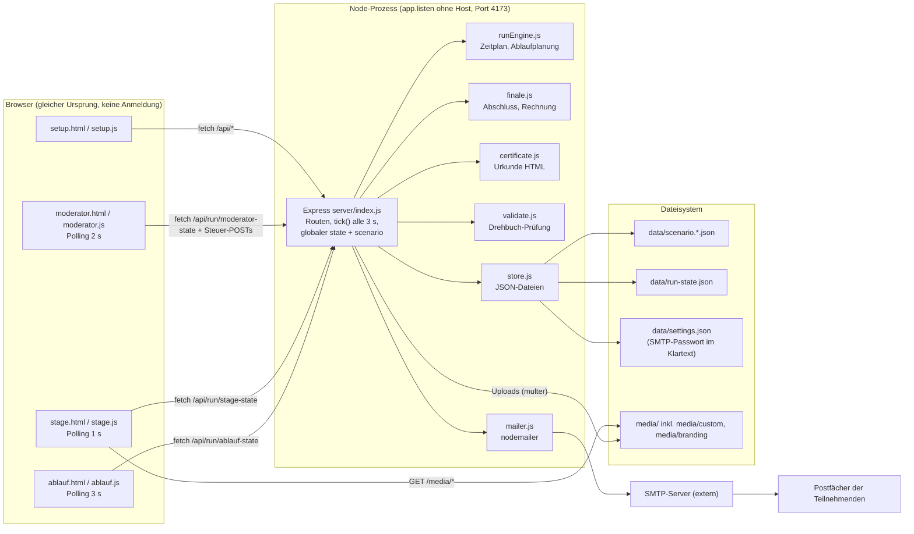
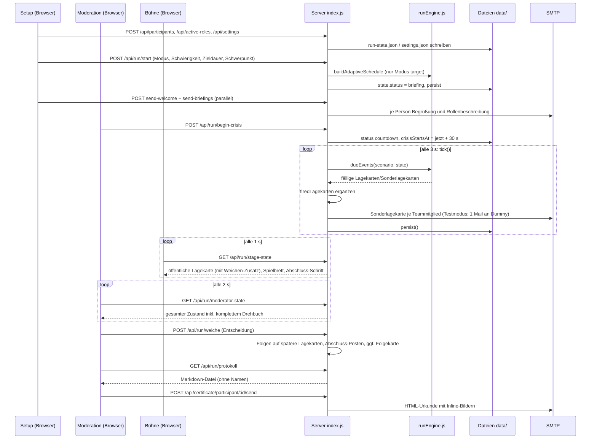

# 03 – Architektur und Datenflüsse

Stand: 2026-11-18 · Codestand `0c8013e`

Die Tabletop-Regie ist eine lokale Node.js-Anwendung (Express) mit drei Browser-Ansichten: **Setup** (Vorbereitung), **Moderation** (nicht teilen, enthält alle vertraulichen Inhalte) und **Bühne** (für alle sichtbar, nur öffentliche Inhalte), dazu eine Ablaufseite für Teilnehmende. Drehbücher sind JSON-Dateien unter `data/`; Lauf- und Einstellungsdaten liegen lokal in `data/run-state.json` und `data/settings.json` und werden nicht eingecheckt. Vertrauliche Karten gehen per SMTP an einzelne Personen.

**Änderungen an der Architektur in dieser Runde:** Standard-Bindung an `127.0.0.1` (Netzbetrieb nur bewusst mit `HOST=0.0.0.0`), Export ohne SMTP-Passwort, Pfadprüfung für Medien, Upload nur für Bildtypen, Eingabeprüfung bei Bewertungen, Sperre gegen parallelen Doppelversand. Sonst ist die Architektur unverändert; die Inventur unten bezieht sich auf den Codestand vor diesen Korrekturen, die betroffenen Stellen sind markiert.

**Verbleibende Architekturgrenzen** (bewusst nicht in dieser Runde geändert): keine Anmeldung und keine Rollentrennung zwischen Moderation und Bühne (Schutz nur durch lokalen Betrieb), Einstellungen ohne Anmeldung änderbar (Mailumleitung möglich, wenn der Server im Netz erreichbar ist), Namen der Personen auf dem Spielbrett der Bühne, Ausfallzeit zählt als Übungszeit, kein erneuter Versand fehlgeschlagener Mails, kein HTTPS, nur eine Übung gleichzeitig.

Ablaufdiagramme der Szenarien (Lagen, Stationen, Entscheidungen) liegen unter `ablaufdiagramme/`.


---


Stand der Inventur: 18.11.2026, Codestand `79c9b89`. Zeilenangaben beziehen sich auf diesen Stand; durch die Korrekturen dieser Runde können sie sich in `server/index.js` um wenige Zeilen verschoben haben. Behobene Befunde sind als „Behoben in dieser Runde“ gekennzeichnet.
Grundlage: ausschließlich Quellcode unter `tabletop-regie/`. Das README wird nur als Vergleich herangezogen, nicht als Beleg.
Belegstellen: `Datei:Zeile` relativ zu `tabletop-regie/`. Bei `public/*.html` beziehen sich die Zeilen auf die jeweilige Datei.

Bewertungen, die aus dem Code abgeleitet, aber nicht durch Ausführung geprüft wurden, sind als **Einschätzung** gekennzeichnet. Der Server wurde für die Inventur selbst nicht gestartet; die Tests dieser Runde stehen in `07-funktions-und-testmatrix.md` und `testberichte/`.

---

### 1. Überblick

Einzelprozess-Webanwendung (Node.js/Express), die auf dem Rechner der Moderation läuft. Ein Server hält genau einen Übungslauf im Speicher, schreibt ihn als JSON-Datei auf die Platte und liefert vier Browser-Oberflächen aus (Setup, Moderation, Bühne, Ablauf). Die Clients fragen den Zustand per Polling ab; Push-Mechanismen (WebSocket, SSE) gibt es nicht. Vertrauliche Karten gehen per E-Mail (SMTP über nodemailer) an die Teilnehmenden.

| Aspekt | Befund | Beleg |
|---|---|---|
| Laufzeit | Node.js >= 20 | `package.json:7-9` |
| Webframework | Express 4 | `package.json:16`, `server/index.js:1,15` |
| Upload | multer 2 (Logo, Audio) | `package.json:17`, `server/index.js:27-37,664-676` |
| E-Mail | nodemailer 10 | `package.json:18`, `server/mailer.js:1-14` |
| QR-Code | qrcode 1.5 (lokal erzeugt) | `package.json:19`, `server/index.js:1336-1345` |
| Frontend | Plain HTML/CSS/JavaScript ohne Framework, ohne Build-Schritt, keine externen Skripte/Fonts | `public/*.html`, `public/*.js` (Suche nach `http(s)://` ergab nur einen Platzhalter und einen Hinweistext: `public/setup.html:202`, `public/setup.js:703`) |
| Persistenz | JSON-Dateien `data/run-state.json`, `data/settings.json` | `server/store.js:6-8,18-21,62-76` |
| Datenbank | keine | `server/store.js:1-2` |
| Tests | Verzeichnis `test/` ist leer; einzige automatische Prüfung ist die Drehbuch-Validierung | `server/validate.js`, `package.json:14` |
| Port | `process.env.PORT` oder 4173 | `server/index.js:1414` |
| Netzwerkbindung | **Behoben in dieser Runde (Sicherheitstest `tools/tests/sicherheit.js`, 10/10; alter Stand 3/10):** Server bindet standardmäßig an `127.0.0.1`; Netzbetrieb nur bewusst mit `HOST=0.0.0.0` (README „Erreichbarkeit“, Ablauf-Seite angepasst). *Ursprünglicher Befund:* `app.listen(PORT)` ohne Host-Argument, d. h. Bindung an alle Schnittstellen, nicht nur `localhost` | `server/index.js:1415` |

### 2. Verzeichnisstruktur

```
tabletop-regie/
  package.json, package-lock.json   Abhängigkeiten, Skripte start/prestart/pruefen
  server/
    index.js        Express-App, alle Routen, Lauf-Steuerung, Versand, Protokoll, Bühnen-/Moderationszustand (1420 Zeilen)
    runEngine.js    Zeitplan, adaptive Ablaufplanung, Empfängerauflösung, Rollenempfehlung (600 Zeilen)
    store.js        Dateipersistenz, Szenario-Laden, Standard-Einstellungen (86 Zeilen)
    mailer.js       nodemailer-Wrapper inkl. Testmodus-Umleitung (50 Zeilen)
    finale.js       Abschluss: Schritte, Rechnung, Sichtbarkeit je Schritt (115 Zeilen)
    certificate.js  Urkunde als HTML (84 Zeilen)
    validate.js     Drehbuch-Prüfung inkl. Simulation, CLI "npm run pruefen" (269 Zeilen)
    check-deps.js   Prüft installierte Pakete gegen package-lock.json (24 Zeilen)
  public/           index, setup, moderator, stage, ablauf (je .html/.js), shared.css
  data/             scenario.nordtech.json, scenario.waterkant.json; zur Laufzeit run-state.json, settings.json (gitignored)
  media/            nordtech/, waterkant/, branding/, starterkit/; zur Laufzeit media/custom/ (gitignored)
  docs/             NordTech-Begleitdokumente (Markdown/CSV), vom Code nicht gelesen
  test/             leer
```

Belege: `.gitignore` (node_modules, data/settings.json, data/run-state.json, media/branding/custom-logo-*, media/custom/); Laufzeitverzeichnisse werden beim Start angelegt: `server/index.js:26` (media/branding), `server/index.js:662` (media/custom). Szenario-Dateien werden nur direkt in `data/` mit Präfix `scenario.` und Endung `.json` erkannt (`server/store.js:23-27`); `data/archiv/` wird daher nicht ausgewertet.

### 3. Komponenten

#### 3.1 Server (`server/index.js`)
- Statische Auslieferung von `public/` und `media/` (`server/index.js:20-21`). `data/` wird nicht statisch ausgeliefert.
- Middleware für alle `/api/run`-Pfade: prüft vor jeder Anfrage, ob der 30-Sekunden-Countdown abgelaufen ist (`server/index.js:19`, `maybeStartCrisisFromCountdown` `:229-239`).
- Globale Prozessvariablen: `scenario`, `scenarioFile` (`:74`), `state` (`:95`), `soundOwner` (`:728`), `soundMuted` (`:740`), `scenarioCheck` (`:86`).
- Takt: `setInterval(tick, 3000)` (`:428`). `tick()` (`:410-427`) löst fällige Lagekarten und Sonderlagekarten aus, verschickt Weichen-Folgekarten, beendet die Übung bei Erreichen der geplanten Zeit und persistiert.
- Laufzeit-Erweiterungen des Drehbuchs: generische Rolle `teilnehmer` (`augmentWithGenericRole` `:56-67`), eigene Töne (`applyMediaOverrides` `:47-54`).

#### 3.2 Zeitplan-Engine (`server/runEngine.js`)
- Lauf-Zustand anlegen: `newRunState` (`:7-35`).
- Uhr: `elapsedMinutes` (`:37-43`), `setElapsedMinutes` für Zeitsprünge (`:511-515`).
- Ablauf je Modus: `computeEffectiveSchedule` (`:82-96`, Modi `authored`/`computed`), `buildAdaptiveSchedule` (`:177-464`, Modus `target`), `getActiveSchedule` (`:467-479`).
- Fälligkeit: `dueEvents` (`:490-495`), `currentLagekarte` (`:497-503`), `crisisClockStarted` (`:486-488`).
- Empfängerauflösung inkl. Ersatzrollen: `resolveRecipient` (`:75-79`).
- Rollenempfehlung: `recommendRoles` (`:529-562`, Tabelle `ROLE_RECOMMENDATION` `:521-527`).
- Spannungsbogen: `AKTE` (`:118-125`).

#### 3.3 Persistenz (`server/store.js`)
- `readJson` liefert bei Lese-/Parsefehler stillschweigend einen Fallback (`:10-16`).
- `writeJson` schreibt synchron und nicht atomar (kein Schreiben in Temp-Datei mit Umbenennen) (`:18-21`).
- `loadSettings` mischt Standardwerte flach mit der Datei (`:62-64`), Standardwerte `:37-60`.
- `loadScenario`: Parameter, sonst `SCENARIO_FILE`, sonst erste Datei alphabetisch (`:29-35`).

#### 3.4 Mailer (`server/mailer.js`)
- Transport je Aufruf neu erzeugt; ohne Host Rückgabe `ok:false` (`:5-15,33-37`).
- Optional `tls.rejectUnauthorized=false`, wenn `allowInsecureTLS` gesetzt (`:12-14`).
- Testmodus-Umleitung mit Betreff-Präfix und Hinweisbanner (`applyTestMode` `:22-31`).
- Fehler werden gefangen und als `{ok:false,error}` zurückgegeben, kein Wiederholversuch (`:39-47`).

#### 3.5 Abschluss (`server/finale.js`)
- Schrittfolge intro, nacharbeiten (je Eintrag), rechnung (je Posten), bilanz, aha (nur mit jahresumsatz und umsatzrendite), fazit (`steps` `:46-57`).
- Rechnung inkl. optionaler Posten, Versicherung (gedeckelt auf Summe), Anteil Jahresgewinn, nötiger Zusatzumsatz (`bill` `:21-44`).
- Schrittweise Sichtbarkeit für die Bühne (`view` `:61-95`), Vorschau für die Moderation (`stepLabel` `:98-113`).

#### 3.6 Urkunde (`server/certificate.js`)
- HTML-Urkunde ohne PDF-Bibliothek, HTML-Escaping aller Werte (`:4-8,14-82`).
- Parameter `score` wird übergeben, im Template aber nicht verwendet (`:14` vs. Template `:50-81`).

#### 3.7 Validierung (`server/validate.js`)
- Strukturprüfungen (Duplikate, Rollenverweise, Medien vorhanden, Weichen, Abschluss, Prioritäten, Akte) `:7-179`.
- Simulation zufälliger Besetzungen/Dauern/Schwierigkeiten mit festem Seed (`:182-249`): 200 Läufe beim Serverstart (`server/index.js:88`), 2000 bei `npm run pruefen` (`server/validate.js:261`).
- Ergebnis erscheint im Setup (`public/setup.js:797-806`) und in der Konsole (`server/index.js:89-91`). Fehler blockieren den Start nicht.

#### 3.8 Oberflächen (`public/`)

| Seite | Zweck | Datenquelle | Polling | Beleg |
|---|---|---|---|---|
| `index.html` | Startseite mit Links | `/api/scenario-meta` | einmalig | `public/index.html:17-27` |
| `setup.html/js` | Vorbereitung | mehrere Setup-Endpunkte | kein Polling | `public/setup.js:792-818` |
| `moderator.html/js` | Moderation | `/api/run/moderator-state` | 2 s | `public/moderator.js:466-468,561` |
| `stage.html/js` | Bühne/Beamer | `/api/run/stage-state` | 1 s | `public/stage.js:154-157,378` |
| `ablauf.html/js` | Teilnehmeransicht, Hilfe | `/api/run/ablauf-state` | 3 s | `public/ablauf.js:7,26` |

### 4. Architekturdiagramm



### 5. Datenflussdiagramm



### 6. Datenmodell der Drehbücher

Nur Felder, die der Code tatsächlich auswertet. Spalte "Vorkommen" zeigt, in welchem Drehbuch das Feld befüllt ist (ermittelt per Skript über beide JSON-Dateien). NT = NordTech (26 Lagekarten, 49 Sonderlagekarten, 8 Bonuskarten, 24 Rollen), WK = Waterkant (18 / 26 / 4 / 16).

#### 6.1 Wurzel

| Feld | Auswertung im Code | Beleg | Vorkommen |
|---|---|---|---|
| `title`, `subtitle` | Anzeige Start/Setup/Moderation, Mails, Protokoll | `server/index.js:433,574,597,967` | NT, WK |
| `company.name`, `company.facts`, `company.logo`, `company.stageLogo` | Bühne (Logo je Hell/Dunkel), Urkunde, Protokoll | `server/index.js:927-930,1358,1375`; `public/stage.js:21-26` | NT, WK |
| `difficulty`, `recommendedParticipants` | nur durchgereicht in `/api/scenario-meta`, im Frontend nicht verwendet | `server/index.js:434` | NT, WK |
| `standardablauf.readingMinutes`, `perRoleSeconds`, `speakingOrder` | Zeitformel, Zählung aktiver Funktionsbereiche | `server/runEngine.js:63,98-103,181,184`; `server/index.js:507` | NT, WK |
| `standardablauf.vorbotenMinuten` | Dauer je Vorboten-Karte (Standard 2) | `server/runEngine.js:130-132` | NT, WK (je 3) |
| `standardablauf.rollenPrioritaet` | feste Reihenfolge der Rollenempfehlung | `server/runEngine.js:549-555` | nur NT |
| `roleGroups[]` (`key`, `label`, `members`) | Setup-Gruppierung, Kompaktbesetzung | `public/setup.js:11-20,27-48,446-450` | NT, WK |
| `roles[]` | siehe 6.2 | | |
| `moderationsleitfaden.begruessung`, `spielregeln` | Begrüßungsmail, Moderation, Ablauf-Seite | `server/index.js:590-600,1037-1038`; `public/moderator.js:291,357` | NT, WK |
| `moderationsleitfaden.eroeffnungstext`, `idleMedia` | Bühne vor Krisenbeginn | `server/index.js:932-933`; `public/stage.js:180,206-211` | NT, WK |
| `moderationsleitfaden.moderationsregel`, `debriefingFragen`, `highlightHinweis` | Moderationsleitfaden; Debriefing-Fragen auch im Protokoll | `public/moderator.js:355-362`; `server/index.js:1012` | NT, WK |
| `sounds.idle` (`src`, `volume`) | Ambience-Schleife auf der Bühne | `server/index.js:934`; `public/stage.js:94-105,111-116` | NT, WK |
| `urkunde.veranstaltung` | Urkundentext, Mailbetreff | `server/certificate.js:15`; `server/index.js:1393` | NT, WK |
| `urkunde.maxPunkte` | Punkteskala der (ungenutzten) Bewertung, Standard 10 | `server/index.js:1305` | in keinem Drehbuch gesetzt |
| `bewertungskriterien` | nur durchgereicht in `/api/scenario-meta`; keine Oberfläche nutzt es | `server/index.js:436` | NT, WK |
| `lagekarten[]`, `sonderlagekarten[]`, `bonuskarten[]`, `weichen[]`, `schwerpunkte[]`, `nachspiel` | siehe unten | | |

Vom Code nicht ausgewertete Felder (Suche ohne Treffer in `server/` und `public/`): `id` (Szenario), `timing`, `debriefMinutes`, `standardablauf.maxDecisionMinutes`, `moderationsleitfaden.abschlussfragenVorDebrief`, `company.produkte`, `sonderlagekarten[].vertraulich`, `sonderlagekarten[].nr`.

#### 6.2 Rollen (`roles[]`)

| Feld | Auswertung | Beleg | Vorkommen |
|---|---|---|---|
| `id`, `funktion`, `beschreibung` | Zuordnung, Mails (Rollenbriefing), Setup-Anzeige, Urkunde | `server/index.js:566-584`; `public/setup.js:35-39`; `server/certificate.js:19` | NT, WK |
| `group` | Funktionsbereich für Zeitformel und Empfehlung; `krisenstab-support` ohne Sprechzeit, nicht empfehlbar | `server/runEngine.js:56-64,535` | NT, WK |
| `ebene` (`eingang`/`krisenstab`/`verteilung`) | Spalte im Spielbrett; unbekannte Werte fallen auf `krisenstab` zurück; Validierung meldet Fehler | `server/index.js:355,400`; `server/validate.js:18-21` | NT, WK (alle 24 bzw. 16 Rollen) |
| `alteIds` | Umschreiben alter Rollen-IDs in Teilnehmerlisten, aktiven Rollen, Vorlagen | `server/index.js:104-113,475-476,553,816` | nur NT (4 Rollen) |
| generische Rolle `teilnehmer` | wird zur Laufzeit angehängt, nicht im JSON | `server/index.js:56-67` | beide |

#### 6.3 Lagekarten (`lagekarten[]`, öffentlich)

| Feld | Auswertung | Beleg | Vorkommen |
|---|---|---|---|
| `id`, `titel`, `text`, `simZeit` | Bühne, Moderation, Ablauf-Seite, Protokoll | `server/index.js:937-942,1029-1032,976` | NT, WK |
| `nr` | Fallback-Nummer auf der Bühne, wenn keine laufende Nummer ermittelbar | `public/stage.js:237` | NT, WK |
| `minuteOffset` | Zeitpunkt im Modus `authored`, Sortierung, Heimatlage | `server/runEngine.js:48,89,233` | NT, WK |
| `diskussionMinuten` | Ende der Übung im Modus `authored` (letzte Lagekarte, Standard 5) | `server/runEngine.js:574` | NT, WK |
| `kriseninfo` | Bühne, Ablauf-Seite; durch Weiche ersetzbar | `server/index.js:301,306,939` | NT, WK (teilweise) |
| `aufgabe[]` | Fragen an den Tisch auf der Bühne; Schwerpunkt-Zusatzfrage wird angehängt | `server/index.js:299,939`; `public/stage.js:234` | NT, WK |
| `moderatorHinweis`, `moderatorGut`, `moderatorSchlecht` | nur Moderation | `public/moderator.js:264-265,279` | NT (Gut/Schlecht nur 3 Karten), WK (nur Hinweis) |
| `media` (`type` image/video, `src`, `caption`, `hochformat`) | Bühne; `video` wird als `<video autoplay>` gerendert | `public/stage.js:355-371` | NT, WK (nur `image`; `video` in keinem Drehbuch) |
| `sound` (`src`, `loop`, `volume`, `signal`) | Bühne spielt beim Erscheinen; `signal` steuert Moderationshinweis "nach dem Signal live sprechen" | `public/stage.js:117-121,143-149`; `public/moderator.js:243-250` | NT 11 Karten (3 mit `signal`), WK 1 Karte |
| `sprechertext` | Moderation (Vorlesen/Abschrift), Setup "Eigene Töne" | `public/moderator.js:246-250`; `server/index.js:689` | nur NT (7 Karten) |
| `gespraech` (`nachfragen[]`, `abschluss`, `gut`, `schwach`) | Gesprächsleitfaden in der Moderation | `public/moderator.js:251-257`; `server/validate.js:60-63` | nur NT (LK04, LK06, LK23) |
| `prioritaet` (1–3) | Auswahl im Modus `target` | `server/runEngine.js:235-238` | NT, WK |
| `akt` | Spannungsbogen, Vorboten-Sonderbehandlung (kürzere Zeit, Ambience läuft weiter) | `server/runEngine.js:118-132,243-251`; `public/stage.js:111-124` | NT, WK |
| `zustaendig[]` | Spielbrett "am Zug", Warnung "nicht besetzt", Bevorzugung im Modus `target`, Rollenempfehlung | `server/index.js:391,405`; `server/runEngine.js:201-202,543` | NT, WK |
| `voraussetzung[]` | Abhängigkeiten im Modus `target` | `server/runEngine.js:216-221` | nur NT (5 Karten) |

#### 6.4 Sonderlagekarten (`sonderlagekarten[]`, vertraulich per E-Mail)

| Feld | Auswertung | Beleg | Vorkommen |
|---|---|---|---|
| `id`, `text` | Mailinhalt, Moderation, Protokoll (gekürzt auf 140 Zeichen) | `server/index.js:209-210,990-991` | NT, WK |
| `empfaenger`, `fallbackEmpfaenger[]` | Empfängerauflösung mit Ersatzrollen | `server/runEngine.js:75-79` | NT, WK |
| `minuteOffset` (null = nur manuell) | Zeitpunkt; ohne Wert nicht im Ablauf | `server/runEngine.js:49-50`; `server/index.js:898` | NT, WK (alle außer SK43/SK44 terminiert) |
| `prioritaet` | Auswahl im Modus `target` | `server/runEngine.js:235-238` | NT, WK |
| `voraussetzung[]`, `zuBeginnVon`, `nurInEigenerLage` | Abhängigkeiten und Zeitbindung im Modus `target` | `server/runEngine.js:356-369` | nur NT |
| `textVarianten[]` (`nachLagekarte`, `text`) | anderer Text, wenn die genannte Lagekarte schon gezeigt wurde | `server/index.js:317` | nur NT (1 Karte) |
| `nurNachWeiche` | Karte erscheint nicht unter "manuell auslösen", nur als Weichenfolge | `server/index.js:898` | nur NT (SK43, SK44) |
| `moderatorHinweis`, `moderatorGut`, `moderatorSchlecht` | Moderation (Hinweisfenster, Liste verschickter Karten); `moderatorGut` auch im Protokoll | `public/moderator.js:136-138,343-345`; `server/index.js:991` | NT, WK |

#### 6.5 Bonuskarten (`bonuskarten[]`, manuell)

| Feld | Auswertung | Beleg | Vorkommen |
|---|---|---|---|
| `id`, `text`, `empfaenger`, `fallbackEmpfaenger[]` | privater Versand per Mail an Rolle oder Ersatzrolle | `server/index.js:1252-1271` | NT (B1–B5), WK (B1–B4) |
| `oeffentlich` | statt Mail: "Überraschung" auf der Bühne über der aktuellen Lage | `server/index.js:1241-1251`; `public/stage.js:214-230` | nur NT (B6, B7, B8) |
| `titel`, `buehnentext`, `kriseninfo`, `media`, `sound` | Bühnendarstellung der öffentlichen Karte; Ton einmalig | `server/index.js:151-152`; `public/stage.js:126-138` | nur NT |
| `sprechertext`, `moderatorHinweis`, `regie` | nur Moderation | `server/index.js:155`; `public/moderator.js:271-275` | nur NT |
| `beobachtung[]` | Beobachtungsliste in der Moderation; Beobachtungsbogen-Tabelle im Protokoll | `server/index.js:155,1001-1005`; `public/moderator.js:273` | nur NT (B6: 3, B7: 5, B8: 3 Punkte) |
| `unterbrechung` (`rolle`, `minuten`, `text`, `rueckkehr`) | Echtzeit-Countdown, Rolle im Spielbrett "nicht erreichbar"; `rueckkehr` als Moderationshinweis nach Ablauf | `server/index.js:149-155,393-395,1247`; `public/moderator.js:270-272` | nur NT (B7: Krisenstabsleitung 5 Min.) |
| `erfordertBesetzt` | Auslösen gesperrt, solange Rolle unbesetzt | `server/index.js:905,1239` | nur NT (B7) |
| `voraussetzung[]` | Auslösen erst nach gezeigten Lagekarten | `server/index.js:906,1236-1237` | nur NT (B6: LK22, B7: LK17, B8: LK14) |
| `minDauer` | Auslösen nur bei geplanter Übungsdauer (Krise + Abschluss) ab x Minuten | `server/index.js:358-360,904,1238` | nur NT (B7: 90) |

#### 6.6 Weichen (`weichen[]`)

| Feld | Auswertung | Beleg | Vorkommen |
|---|---|---|---|
| `id`, `frage`, `hinweis`, `lagekarten[]` | Weiche hängt an der ersten ihrer Lagekarten im Plan | `server/index.js:283-289,336-348` | nur NT (W1–W4) |
| `optionen[]` (`id`, `label`, `wirkung`) | Auswahl in der Moderation | `public/moderator.js:402-408` | nur NT |
| `optionen[].folgen[]` (`lagekarte` + `zusatz`/`kriseninfo`) | Satz an spätere Lagekarte anhängen bzw. Kriseninfo ersetzen (Bühne, Ablauf, Moderation) | `server/index.js:296-311` | nur NT |
| `optionen[].folgen[]` (`sonderlagekarte` + `text`) | Text einer vertraulichen Karte ersetzen | `server/index.js:318-321` | nur NT (1 Folge) |
| `optionen[].karte` (`sonderlagekarte`, `beiLagekarte`) | Folgekarte verschicken, sobald die Lagekarte gezeigt wurde | `server/index.js:324-335` | nur NT (SK43, SK44, SK27) |
| `optionen[].posten[]` | schaltet optionale Abschluss-Posten passend zur Entscheidung | `server/index.js:1185-1188` | nur NT |

#### 6.7 Schwerpunkte (`schwerpunkte[]`)

| Feld | Auswertung | Beleg | Vorkommen |
|---|---|---|---|
| `key`, `label`, `beschreibung` | Auswahl im Setup (nur Modus `target`) | `server/index.js:439`; `public/setup.js:298-303` | nur NT (fuehrung, it, produktion, kunden) |
| `karten[]` | Bevorzugung beim Auffüllen; Bonuskarten oben mit "passt zum Schwerpunkt" | `server/runEngine.js:226-232,409`; `public/moderator.js:323-327` | nur NT |
| `pflicht[]` | vertrauliche Karten, die immer kommen (sofern erreichbar) | `server/runEngine.js:403-406` | nur NT (je 1 Karte) |
| `zusatzfragen{}` | zusätzliche Frage an die Lagekarte (Bühne) | `server/index.js:292-299` | nur NT |
| `leitfrage`, `debriefing[]` | Moderation; Debriefing-Fragen auch im Protokoll | `server/index.js:875,1012`; `public/moderator.js:266,360` | nur NT |

#### 6.8 Abschluss (`nachspiel`)

| Feld | Auswertung | Beleg | Vorkommen |
|---|---|---|---|
| `titel`, `einleitung`, `fazit`, `hinweis` | Bühnenschritte | `server/finale.js:77-93` | NT, WK |
| `nacharbeiten[]` (`zahl`, `text`) | je Eintrag ein Aufdeck-Schritt | `server/finale.js:49-50` | NT, WK |
| `rechnung[]` (`posten`, `betrag`, `bcmHebel`) | Posten mit "Was vorher geholfen hätte" | `server/finale.js:14,52`; `public/stage.js:325` | NT, WK |
| `optionalePosten[]` (`id`, `frage`, `posten`, `betrag`) | in der Moderation an-/abwählbar, bei NT zusätzlich über Weichen | `server/index.js:890,1195-1206` | NT (4), WK (2) |
| `versicherung` (`text`, `betrag`, `erlaeuterung`) | Erstattung, gedeckelt auf Summe | `server/finale.js:24,32-33` | NT, WK |
| `jahresumsatz`, `umsatzrendite` | "Aha"-Schritt (Anteil Jahresgewinn, nötiger Zusatzumsatz) | `server/finale.js:26-42,54` | NT, WK |

### 7. Zustandsverwaltung

#### 7.1 Lauf-Zustand
Ein einziges Objekt `state` (Struktur `server/runEngine.js:7-35`): Status (`idle`, `briefing`, `countdown`, `running`, `paused`, `ended`), Zeitmodus, Plan (nur Modus `target` eingefroren), Teilnehmende, aktive Rollen, ausgelöste Karten, Weichen, Abschluss-Schritt, Bewertung, Ereignisprotokoll (max. 200 Einträge, `server/index.js:128-131`). Zusätzlich zur Laufzeit gesetzte Felder: `buehnenEreignis`, `soundReplay`, `endedAt`, `schwerpunkt`, `firedBonusInfo`.

Nicht persistiert und nur im Prozessspeicher: `soundMuted` (`server/index.js:740`), `soundOwner` (`:728`), `scenarioCheck` (`:86`).

#### 7.2 Persistenz
- `persist()` schreibt den gesamten Zustand nach jeder Änderung (`server/index.js:115`) und bei jedem Takt während `running` (`:426`), also etwa alle 3 Sekunden.
- Einstellungen werden bei fast jedem Zugriff frisch von der Platte gelesen (`store.loadSettings()`), z. B. `server/index.js:174,178,205`.
- Schreiben ist synchron und nicht atomar (`server/store.js:18-21`). Ist `run-state.json` beschädigt, startet der Server stillschweigend mit leerem Zustand inkl. leerer Teilnehmerliste (`server/store.js:10-16,70-72`, `server/index.js:95`).

#### 7.3 Neustart und Wiederaufnahme
- Beim Start wird `run-state.json` geladen (`server/index.js:95`), Rollen-Aliasse angewendet (`:113`).
- Die Uhr basiert auf Wandzeit (`startedAt`, `totalPausedMs`; `server/runEngine.js:37-43`). War der Lauf beim Absturz im Status `running`, zählt die Ausfallzeit als Übungszeit. **Einschätzung:** Beim ersten Takt nach dem Neustart werden alle in der Zwischenzeit fällig gewordenen Lage- und Sonderlagekarten auf einmal ausgelöst und verschickt. Im Status `paused` bleibt die Zeit stehen.
- Stummschaltung geht beim Neustart verloren (`soundMuted = false`, `server/index.js:740`); der Bühnenton läuft danach wieder.
- Ton-Eigentümer wird nach Neustart vom ersten Bühnenfenster mit aktiviertem Ton neu beansprucht (`public/stage.js:75`).
- Wird beim Neustart per `SCENARIO_FILE` ein anderes Drehbuch geladen als im gespeicherten Zustand, wird nur `state.scenarioFile` überschrieben, der Zustand aber nicht zurückgesetzt (`server/index.js:74,96`). Auswirkung: unklar, da ausgelöste IDs dann zu einem anderen Drehbuch gehören; ein Szenariowechsel über die Oberfläche setzt dagegen sauber zurück (`server/index.js:460-487`).

#### 7.4 Mandanten und Sitzungen
Nicht vorhanden. Es gibt genau ein globales Drehbuch und einen globalen Lauf pro Serverprozess (`server/index.js:74,95`). Keine Sitzungen, keine Benutzer, keine Trennung zwischen Moderation und Teilnehmenden auf Serverebene. Mehrere parallele Übungen erfordern mehrere Prozesse mit unterschiedlichem Port und unterschiedlichem Arbeitsverzeichnis (da `data/` fest relativ zum Code liegt, `server/store.js:6`). Das README nennt dies selbst als Grenze (README:523).

### 8. Rollen- und Teilnehmerzuordnung

- Teilnehmende: `{id, name, email, roleIds[]}`; IDs per `crypto.randomUUID()`, sofern der Client keine ID mitschickt (`server/index.js:548-555`). Die Liste wird bei jedem Speichern vollständig ersetzt (`:557-561`).
- Mehrere Rollen je Person und mehrere Personen je Rolle (Teams) sind möglich; vertrauliche Karten gehen an alle Personen der Empfängerrolle (`server/index.js:120-122,206-217`).
- Aktive Rollen (Vorauswahl für das Setup) getrennt gespeichert (`server/index.js:615-622`).
- Rollenempfehlung nach Dauer (45/60/90/120/180 Min. → 5/6/9/12/alle Rollen) (`server/runEngine.js:521-562`).
- Import aus Excel/CSV (Tab, Semikolon, Komma; mit/ohne Kopfzeile; Windows-1252-Fallback) rein clientseitig (`public/setup.js:337-413`).
- Gleichmäßige Teamverteilung clientseitig (`public/setup.js:134-154`).
- Serverseitig keine Prüfung der E-Mail-Adressen (`server/index.js:548-555`); nur der Import prüft per Regex (`public/setup.js:366`).

#### 8.1 Ersatzrollen
`resolveRecipient` (`server/runEngine.js:75-79`): eigentliche Rolle, sonst erste besetzte Rolle aus `fallbackEmpfaenger`, sonst `null` (Karte entfällt). Ohne jede Besetzung gilt die eigentliche Rolle. In der Mail steht ein Hinweis, warum die Karte bei der Ersatzrolle landet (`server/index.js:167-171`). Die Setup-Vorschau zeigt Umleitungen (`server/index.js:516-522`, `public/setup.js:277-278`), die Moderation markiert "statt ..." (`server/index.js:160-166`, `public/moderator.js:124,135`). Nicht erreichbare Karten werden in allen Zeitmodi nicht eingeplant (`server/runEngine.js:86-87,196-197`).

### 9. E-Mail, SMTP und Testmodus

- SMTP-Felder: Host, Port, secure, Benutzer, Passwort, Absenderadresse/-name, `allowInsecureTLS` (`server/store.js:38`; `public/setup.html:153-162`).
- Passwort im Klartext in `data/settings.json`; `GET /api/settings` maskiert es (`server/index.js:625-628`), Platzhalter wird beim Speichern erkannt (`:633`). `GET /api/template/export` liefert es unmaskiert (`:771-788`).
- Versandarten: Begrüßung (`:589-610`), Rollenbriefing (`:566-584`), Sonderlagekarte (`:190-221`), private Bonuskarte (`:1252-1271`), Urkunde mit Inline-Bildern (`:1366-1412`), Test-E-Mail (`:752-761`).
- Versand sequenziell je Empfänger, ohne Warteschlange, ohne Wiederholung. Ergebnis je Empfänger im Log und bei Sonderlagekarten in `emailResults` (`:212-216`).
- Testmodus (`settings.testMode`): alle Mails an eine Dummy-Adresse mit Betreff `[TESTLAUF → ...]` und Banner (`server/mailer.js:22-31`). Bei Sonder- und Bonuskarten genau eine Mail je Karte statt je Teammitglied (`server/index.js:173-188,199-203,1260-1261`). Ausnahme: Die Test-E-Mail im Setup wird nicht umgeleitet (`server/index.js:756-759`, kein `testMode`-Argument). Warnbanner in Setup und Moderation (`public/setup.js:554-562`, `public/moderator.js:161-167`).

### 10. Bühne und Moderation

| Aspekt | Bühne | Moderation | Beleg |
|---|---|---|---|
| Endpunkt | `/api/run/stage-state` | `/api/run/moderator-state` | `server/index.js:921,827` |
| Polling | 1 s | 2 s | `public/stage.js:378`; `public/moderator.js:561` |
| Inhalt | aktuelle Lagekarte (gefilterte Felder), öffentliche Überraschung ohne Moderationsfelder, Spielbrett, Abschluss-Schritt | vollständiger Zustand inkl. ganzem Drehbuch, Teilnehmenden mit E-Mail, Log | `server/index.js:921-953,867-918` |
| Ton | Ambience, Lagekarten-Ton, Überraschungs-Ton | nur Signalton bei neuer vertraulicher Karte (WebAudio) | `public/stage.js:63-151`; `public/moderator.js:100-116` |

Ton-Eigentümer-Logik: Jedes Bühnenfenster erzeugt eine Zufalls-ID (`public/stage.js:39`) und beansprucht beim Klick auf "Ton aktivieren & Übung anzeigen" den Ton (`:52-61`, `POST /api/stage/sound-claim`, `server/index.js:729-734`). Der Server merkt sich nur die zuletzt beanspruchende ID. Andere Fenster pausieren und zeigen "Ton läuft in einem anderen Fenster – hier abspielen" (`public/stage.js:76-84`, `public/stage.html:127`). Ein Fenster mit "Ohne Ton anzeigen" beansprucht nie (`public/stage.js:46-51,64`).

Stummschaltung: Moderation "Ton aus"/"Ton an" setzt `soundMuted` (`server/index.js:741-745`, `public/moderator.js:471-474`); die Bühne pausiert sofort beim nächsten Poll (`public/stage.js:66-73`). Bleibt beim Zurücksetzen erhalten, geht beim Serverneustart verloren.

"Ton noch einmal abspielen": Zähler `soundReplay` bzw. `buehnenEreignis.replay` (`server/index.js:746-750,1283-1286`), die Bühne vergleicht Zählerstände (`public/stage.js:85-87,129`).

Browser-Autoplay: Die Bühne verlangt einen Klick zur Tonfreigabe (`public/stage.html:98-102`). Abspielfehler werden verschluckt (`.play().catch(() => {})`, z. B. `public/stage.js:100,120,148`).

### 11. Timer, Pause, Zeitsprung

- Start in zwei Stufen: `POST /api/run/start` setzt `briefing` ohne Uhr (`server/index.js:1044-1090`), `POST /api/run/begin-crisis` setzt `countdown` mit festen 30 Sekunden (`:1091-1100`); Umschalten auf `running` in `maybeStartCrisisFromCountdown` (`:229-239`).
- Vor Krisenbeginn ist nichts fällig (`server/runEngine.js:486-495`).
- Pause/Fortsetzen über `pausedAt`/`totalPausedMs` (`server/index.js:1208-1215`); während der Pause löst `tick` nichts aus (`:412`). Bonuskarten und Weichen bleiben während der Pause bedienbar (`:1243`, `:1177-1194`).
- Zeitsprung auf Ereignis oder beliebige Minute (`server/index.js:1114-1140`) über `setElapsedMinutes` (`server/runEngine.js:511-515`); anschließend `tick()`, d. h. dazwischen fällige Sonderlagekarten werden sofort verschickt. Rücksprünge sind möglich; bereits ausgelöste Karten bleiben ausgelöst und werden nicht erneut verschickt (`server/index.js:191`).
- Automatisches Ende bei Erreichen der geplanten Zeit, danach automatischer Abschluss (`server/index.js:419-425,248-254`).
- Zurücksetzen behält Teilnehmende und aktive Rollen (`server/index.js:1216-1226`).

### 12. Ablaufplanung

Drei Modi (`server/runEngine.js:12`):
- `authored`: Minuten aus dem Drehbuch; Ende = letzte Lagekarte + `diskussionMinuten` (`:88-90,573-575`). Schwierigkeit wirkt hier nicht. Rechnerisch (beide Drehbücher, alle Rollen besetzt) 92 Minuten Krisenphase plus 9 Minuten Abschluss (per Skript ermittelt; README nennt 87 Minuten).
- `computed`: alle Karten; je Lagekarte Lesezeit + Sprechzeit je aktivem Funktionsbereich + Entscheidungszeit (leicht 2, mittel 4, hoch 6 Min.) (`:5,93-103`). Rechnerisch bei Vollbesetzung NT 239 Min., WK 166,5 Min.
- `target` (Zieldauer): `buildAdaptiveSchedule` (`:177-464`):
  - Abschlusszeit 10 % der Zieldauer, mindestens 4, höchstens 15 Min. (`:135-138`).
  - Pflicht: Priorität-1-Karten, je Akt mindestens eine Lagekarte (`:240-258`), Voraussetzungen werden mitgezogen (`:216-221`).
  - Auffüllen nach effektiver Priorität (Schwerpunkt verschiebt um eine halbe bis ganze Stufe), besetzter Zuständigkeit, Nachzugskosten, schwächstem Akt, Zeit (`:228-232,309-329`).
  - Reicht die Zeit nicht: Vorboten auf min. 2 Min., dann Entscheidungszeit auf min. 1 Min. komprimieren, Warnung (`:265-293,447-452`); Restzeit verlängert Entscheidungsphasen bis Faktor 2 (`:332-343`).
  - Vertrauliche Karten: Zeitbindung an Heimatlage, `zuBeginnVon`, `nurInEigenerLage`, Voraussetzungen (`:354-387`); Schwerpunkt-Pflichtkarten (`:403-406`); jede besetzte Rolle mindestens eine eigene Karte (`:416-423`); Mengendeckel ca. 1,3 je Lagekarte, bei kurzen Entscheidungsphasen weniger, und Obergrenze je Empfänger (`:428-436`).
  - Plan wird beim Start eingefroren (`server/index.js:1060-1072`); übersprungene Karten können nachträglich aufgenommen werden (`:1101-1110`).
- Mengenbegrenzung und Rollenabdeckung gelten nur im Modus `target`. In `authored`/`computed` werden alle terminierten, erreichbaren Sonderlagekarten verschickt.
- Die Planung ist deterministisch (keine Zufallsfunktion in `buildAdaptiveSchedule`); gleiche Eingaben ergeben denselben Plan.

### 13. Entscheidungs- und Folgenlogik (Weichen)

- Anzeige an der ersten Weichen-Lagekarte im Plan; nicht im Plan enthaltene Weichen entfallen (`server/index.js:283-289`).
- Festhalten oder Zurücknehmen per `POST /api/run/weiche` (`:1177-1194`), jederzeit möglich, auch nachträglich.
- Wirkungen: Zusatzsatz bzw. ersetzte Kriseninfo bei späteren Lagekarten (`:296-311`), ersetzter Text einer vertraulichen Karte (`:314-323`), Folgekarte beim Erreichen einer Lagekarte (`:324-335`, aufgerufen in `tick` `:418` und nach Entscheidung `:1191`), Abschluss-Posten (`:1185-1188`).
- Grenze: Eine bereits verschickte Folgekarte wird bei Zurücknahme der Entscheidung nicht zurückgeholt; ebenso wirken Text-Folgen nur auf noch nicht verschickte Karten (Logik `:191,314-323`).

### 14. Protokoll-Export

`GET /api/run/protokoll` (`server/index.js:961-1021`) erzeugt eine Markdown-Datei zum Download mit: Kopf (Datum, Modus, Schwierigkeit, Schwerpunkt), Besetzung nur als Funktionen und Anzahl (keine Namen, `:970-973`), gespielte Lagen, je Weiche Entscheidung und leere Bewertungstabelle (5 Kriterien), verschickte vertrauliche Karten (Text auf 140 Zeichen gekürzt, gute Reaktion), Überraschungen und Beobachtungsbögen, Rechnung, Debriefing-Fragen mit Notizfeld, Gesamteinschätzung (8 fest kodierte Kriterien, 0/1/2, `:1013-1016`), leerer Maßnahmenplan (3 Zeilen, `:1017`). Die 8 Kriterien sind für beide Drehbücher identisch und enthalten u. a. "IT-/OT-Sicherheit", was zu Waterkant (Brandszenario) nur bedingt passt. Gespeichert wird das Protokoll nicht serverseitig.

### 15. Urkunden

- Vorschau im Browser (`GET /api/certificate/participant/:id`, `server/index.js:1347-1364`) und Versand per Mail mit Inline-Bildern über `cid:` (`:1366-1412`).
- Inhalt: Name, Rolle(n) ohne generische Rolle, Veranstaltung, Ort, Datum, Logos, optional Call-to-Action mit Link, Screenshot und QR-Code (`server/certificate.js:14-82`).
- Teilnahmebestätigung ohne Note: der berechnete `score` (`server/index.js:1299-1314`) wird nicht dargestellt.
- Keine PDF-Erzeugung.

### 16. Sicherheit

| Thema | Befund | Beleg |
|---|---|---|
| Netzwerkbindung | Keine Host-Angabe: Der Server ist auf allen Netzwerkschnittstellen erreichbar, obwohl Konsole, Startseite und README "localhost"/"nur dieser Rechner" sagen. Die Ablauf-Seite empfiehlt sogar die Freigabe "im selben Netzwerk". | `server/index.js:1414-1416`; `public/index.html:11`; `public/ablauf.html:57` |
| Authentifizierung/Autorisierung | Keine. Keine Middleware, keine Passwörter, keine Tokens, keine Rollen. Setup, Moderation, Bühne und Ablauf nutzen dieselbe offene API. | `server/index.js` (keine Auth-Logik; Suche nach auth/token/password ergab nur die SMTP-Felder) |
| Moderations-API für Teilnehmende | Jeder, der den Server erreicht (z. B. vom Bühnenrechner oder aus dem WLAN), kann `GET /api/run/moderator-state` abrufen und alle Steuer-Endpunkte aufrufen (zurücksetzen, springen, Karten auslösen, Urkunden versenden, Einstellungen ändern). Die Trennung "Bühne teilbar / Moderation nicht teilen" ist nur organisatorisch (Hinweistexte). | `server/index.js:827-918`; `public/moderator.html:54` |
| Umleitung vertraulicher Mails | Über `POST /api/settings` lassen sich ohne Anmeldung Testmodus und Dummy-Adresse oder der SMTP-Host setzen; danach gehen alle vertraulichen Karten an die gesetzte Adresse. **Einschätzung**, nicht ausgeführt. | `server/index.js:629-649`; `server/mailer.js:22-31` |
| SMTP-Passwort | **Behoben in dieser Runde (Sicherheitstest `tools/tests/sicherheit.js`, 10/10; alter Stand 3/10):** Der Vorlagen-Export enthält nur noch den Platzhalter „••••••••“; der Import des Platzhalters lässt das gespeicherte Passwort unverändert. Weiterhin Klartext in `data/settings.json`. *Ursprünglicher Befund:* Klartext in `data/settings.json`; maskiert in `GET /api/settings`, aber unmaskiert und ohne Anmeldung abrufbar über `GET /api/template/export`. | `server/store.js:38`; `server/index.js:625-628,771-788` |
| Pfad-Traversal Logo | **Behoben in dieser Runde (Sicherheitstest `tools/tests/sicherheit.js`, 10/10; alter Stand 3/10):** `mediaUrlToFile` löst den Pfad auf und liefert nur Dateien innerhalb von `media/`. *Ursprünglicher Befund:* `branding.logo` ist per `POST /api/settings` frei setzbar. `mediaUrlToFile` verbindet den Pfad ohne Normalisierungsprüfung. Ein Wert der Form `/media/branding/custom-logo-` gefolgt von `../`-Segmenten erfüllt die Präfixprüfung im Export und zeigt außerhalb von `media/` (rechnerisch mit `path.join` nachvollzogen, z. B. auf `data/settings.json`). **Einschätzung:** Beliebige für den Prozess lesbare Dateien sind so über `GET /api/template/export` (Base64) auslesbar und würden beim Urkundenversand als Anhang verschickt. | `server/index.js:776-780,1323-1332,1376,1381` |
| Uploads | **Behoben in dieser Runde (Sicherheitstest `tools/tests/sicherheit.js`, 10/10; alter Stand 3/10):** Logo nur PNG/JPEG/GIF/WEBP; die Endung folgt dem Bildtyp, nicht dem Dateinamen; SVG auch beim Vorlagen-Import ausgeschlossen. Audio-Upload unverändert (MIME-Prüfung, Endung im Fallback aus dem Namen). *Ursprünglicher Befund:* Logo- und Audio-Upload prüfen nur den vom Client gemeldeten MIME-Typ; die Dateiendung stammt beim Logo immer und beim Audio im Fallback aus dem Originalnamen. **Einschätzung:** Eine `.html`- oder `.svg`-Datei mit Bild-/Audio-MIME-Typ würde unter `/media/...` mit gleichem Ursprung ausgeliefert (gespeichertes XSS mit Vollzugriff auf die API). Vorlagen-Import erlaubt `.svg` als Logo. | `server/index.js:27-37,664-676,801` |
| Prototype Pollution | **Behoben in dieser Runde (Sicherheitstest `tools/tests/sicherheit.js`, 10/10; alter Stand 3/10):** `/api/bewertung` akzeptiert nur vorhandene Rollen und Kriterien des Drehbuchs. *Ursprünglicher Befund:* `POST /api/bewertung` verwendet `roleId` und `kriterium` ungeprüft als Objektschlüssel. Mit `roleId = "__proto__"` wird `Object.prototype` beschrieben (Sprachverhalten in Node isoliert nachvollzogen). **Einschätzung:** Kann die Logik global verändern (z. B. jedes Objekt erhält ein Feld wie `oeffentlich`). | `server/index.js:1289-1297` |
| XSS in Oberflächen | Setup setzt Teilnehmername und -mail unescaped in `value="..."`; Moderation setzt die vom Client frei wählbare Teilnehmer-ID unescaped in Attribute und URLs; Rollen-/Szenariotexte im Setup unescaped. Andere Ausgaben nutzen `escapeHtml`. | `public/setup.js:160-161,17,30-39,427`; `public/moderator.js:369-373`; `server/index.js:550` |
| CSRF | Kein CSRF-Schutz. **Einschätzung:** POST-Endpunkte ohne Body (z. B. `/api/run/reset`, `/api/run/fire-sonderkarte/:id`, `/api/participants/send-welcome`) sind als "einfache Anfragen" auch von fremden Webseiten im Browser der Moderation auslösbar. Nicht getestet. | `server/index.js:16` (nur JSON-Parser), Routen ohne Prüfung |
| Transport | Kein HTTPS. Mikrofonaufnahme funktioniert deshalb nur unter `localhost` (sicherer Kontext). | `server/index.js:1415`; `public/setup.js:700-703` |
| Statische Auslieferung | `media/` wird vollständig ausgeliefert, auch künftige Lagebilder (Spoiler) und eigene Aufnahmen in `media/custom/`. `data/` wird nicht statisch ausgeliefert. | `server/index.js:20-21` |
| Grenzen/Missbrauch | JSON-Body bis 20 MB, keine Rate-Limits, keine Begrenzung der Mailmenge. | `server/index.js:16` |
| SMTP-TLS | Prüfung des Zertifikats abschaltbar (Option, standardmäßig aus). | `server/mailer.js:12-14`; `server/store.js:38` |

#### 16.1 Vertraulichkeit: Welche Endpunkte liefern was aus?

| Endpunkt | Vertrauliche Kartentexte | Personenbezogene Daten | Sonstiges Sensibles | Beleg |
|---|---|---|---|---|
| `GET /api/run/moderator-state` | ja, vollständig: komplettes Drehbuch (`scenario`), alle Sonderlagekarten, Bonuskarten, Moderationshinweise, übersprungene Karten mit Text, verschickte Karten | Namen und E-Mail aller Teilnehmenden, Log mit Namen und Adressen | Testmodus-Dummy-Adresse | `server/index.js:867-918` |
| `GET /api/run/protokoll` | ja, gekürzt (140 Zeichen) plus Moderationshinweise und Beobachtungspunkte | nein (bewusst ohne Namen) | – | `server/index.js:987-1005` |
| `GET /api/template/export` | nein | Namen und E-Mail aller Teilnehmenden | Logo-Datei; SMTP-Passwort nur noch als Platzhalter (behoben) | `server/index.js:771-788` |
| `GET /api/participants` | nein | Namen, E-Mail, Rollen | – | `server/index.js:547` |
| `GET /api/settings` | nein | Dummy-Adresse, SMTP-Benutzer, Absender | Passwort maskiert | `server/index.js:625-628` |
| `GET /api/lagekarten-toene` | nein | nein | Titel und Sprechertexte aller, auch künftiger Lagekarten (Spoiler) | `server/index.js:686-692` |
| `GET /api/scenario-meta` | nein | nein | Rollenbeschreibungen, Moderationsleitfaden inkl. Debriefing-Fragen und Moderationsregel | `server/index.js:431-442` |
| `GET /api/run/stage-state` | nein (nur öffentliche Felder; Bonus-Überraschung ohne Sprechertext/Regie/Beobachtung) | ja: Namen der besetzten Rollen im Spielbrett | – | `server/index.js:921-953,401` |
| `GET /api/run/ablauf-state` | nein (nur bereits gezeigte Lagekarten) | nein | – | `server/index.js:1023-1042` |
| `GET /api/certificate/participant/:id` | nein | Name, Rollen der angefragten Person (ID nötig, über `/api/participants` erhältlich) | – | `server/index.js:1347-1364` |
| `GET /media/*` | nein | eigene Sprachaufnahmen | künftige Lagebilder (Spoiler) | `server/index.js:21` |

### 17. Fehlerbehandlung

- Kein globaler Express-Fehlerbehandler; Routen validieren Eingaben punktuell mit 400/404 (z. B. `server/index.js:1092-1094,1119-1120,1236-1240`).
- Mailfehler werden gefangen, protokolliert und in der Moderation rot angezeigt mit der Aufforderung, die Karte mündlich oder auf Papier zu übergeben (`server/mailer.js:45-47`; `public/moderator.js:126-128`). Kein Wiederholen-Knopf.
- **Behoben in dieser Runde:** Eine Sperre je Karte (`skImVersand`) verhindert parallelen Doppelversand; Lauftest N9 (dreifach gleichzeitig ausgelöst → genau eine Mail je Person) bestanden. *Ursprünglicher Befund:* `tick()` ruft `fireSonderlagekarte` und `fireWeichenKarten` ohne `await` auf (`server/index.js:417-418`). Die Doppelprüfung (`:191`) erfolgt vor dem Versand, der Eintrag in `firedSonderlagekarten` erst danach (`:219`). **Einschätzung:** Dauert der Versand länger als ein Takt (3 s) oder wird manuell parallel ausgelöst, kann dieselbe Sonderlagekarte mehrfach verschickt werden. Bonuskarten sind dagegen vor dem Versand als ausgelöst markiert (`:1255`).
- Clients ignorieren Netzwerkfehler und behalten die letzte Ansicht (`public/stage.js:156-157`; `public/moderator.js:467`; `public/ablauf.js:7`); keine Offline-Anzeige.
- Defektes Drehbuch beim Start: Fallback auf erste Datei, sonst Prozessende (`server/index.js:74-81`).
- Validierungsfehler im Drehbuch werden angezeigt, blockieren den Start aber nicht (`public/setup.js:797-806`).

### 18. Deployment und Betriebsanforderungen

- Node.js >= 20 (`package.json:7-9`); Start über `npm start` mit vorgeschalteter Paketprüfung `check-deps.js` und ggf. `npm install` (Internet nötig) (`package.json:12-13`, `server/check-deps.js:9-24`). Startskripte `start.sh`/`start.bat` liegen eine Ebene höher und rufen `npm start` auf (`../start.sh:28-30`, `../start.bat:21-23`).
- Umgebungsvariablen: `PORT` (`server/index.js:1414`), `SCENARIO_FILE` (`server/store.js:32`, `server/index.js:74`).
- Schreibrechte auf `data/`, `media/branding/`, `media/custom/` (`server/store.js:18-21`; `server/index.js:26,662`).
- Ausgehend: SMTP-Server; beim Start ggf. npm-Registry.
- Kein Dienst-/Daemon-Betrieb, kein Logging in Dateien (Konsole und `state.log`), keine Backups, keine Containerdefinition.
- Browser: keine Kompatibilitätsliste im Code. Genutzt werden `fetch`, ES2017+ (async/await), `localStorage` (Bühnen-Theme), `AudioContext`, `MediaRecorder`/`getUserMedia` (optional), `TextDecoder`. Welche Browser getestet sind, ist im Code nicht erkennbar (unklar).

### 19. Bekannte Grenzen (aus dem Code abgeleitet)

1. Kein Zugriffsschutz, Bindung an alle Netzwerkschnittstellen (Abschnitt 16).
2. Ein Lauf und ein Drehbuch je Prozess; keine Mandanten, keine Sitzungen.
3. Polling statt Push: Bühne bis 1 s, Moderation bis 2 s, Kartenauslösung bis 3 s Verzögerung; Moderation lädt alle 2 s das komplette Drehbuch (NordTech-Datei ca. 139 KB).
4. Wandzeit-Uhr: Serverausfall im Status `running` zählt als Übungszeit; danach Sammelauslösung.
5. Stummschaltung und Ton-Eigentümer nicht persistent.
6. Mögliche Doppelversendung von Sonderlagekarten bei langsamem SMTP (Einschätzung, Abschnitt 17).
7. Kein erneuter Versand fehlgeschlagener Mails per Knopf.
8. Bewertungsmatrix nur als API ohne Oberfläche; Ergebnis wird nirgends angezeigt.
9. Protokoll-Gesamteinschätzung mit fest kodierten, NordTech-nahen Kriterien.
10. Kein PDF-Export (weder Protokoll noch Urkunde).
11. Schwierigkeitsgrad wirkt im Modus `authored` nicht.
12. Mengenbegrenzung vertraulicher Karten und Rollenabdeckung nur im Modus `target`.
13. Nicht atomares Schreiben der Zustandsdatei; beschädigte Datei führt zu stillem Neustart mit leerem Zustand.
14. Keine automatisierten Tests außer der Drehbuch-Simulation.
15. Medienfehler (fehlende Bild-/Tondatei) werden auf der Bühne nicht angezeigt; nur die Drehbuch-Prüfung meldet fehlende Dateien vorab.

### 20. HTTP-Endpunkte

Alle Endpunkte ohne Authentifizierung. "Aufrufer" nennt die Oberfläche, die den Endpunkt nutzt.

| Methode | Pfad | Zweck | Aufrufer | Belegstelle |
|---|---|---|---|---|
| (Middleware) | `/api/run/*` | Countdown-Übergang vor jeder Lauf-Anfrage prüfen | – | `server/index.js:19` |
| GET | `/*` (statisch) | Auslieferung `public/` | alle | `server/index.js:20` |
| GET | `/media/*` (statisch) | Auslieferung `media/` | Bühne, Setup, Urkunde | `server/index.js:21` |
| GET | `/api/scenario-meta` | Drehbuch-Metadaten, Rollen, Leitfaden, Prüfergebnis | Start, Setup | `server/index.js:431` |
| GET | `/api/scenarios` | Liste der Drehbücher, aktives Drehbuch | Setup | `server/index.js:448` |
| POST | `/api/scenarios/select` | Drehbuch wechseln, Lauf zurücksetzen | Setup | `server/index.js:489` |
| GET | `/api/recommend-roles` | Rollenempfehlung nach Dauer | Setup | `server/index.js:494` |
| POST | `/api/preview-schedule` | Vorschau Zieldauer-Plan | Setup | `server/index.js:501` |
| GET | `/api/participants` | Teilnehmerliste lesen | Setup | `server/index.js:547` |
| POST | `/api/participants` | Teilnehmerliste ersetzen | Setup | `server/index.js:557` |
| POST | `/api/participants/send-briefings` | Rollenbeschreibungen mailen | Setup | `server/index.js:566` |
| POST | `/api/participants/send-welcome` | Begrüßung und Spielregeln mailen | Setup | `server/index.js:589` |
| GET | `/api/active-roles` | aktive Rollen lesen | Setup | `server/index.js:615` |
| POST | `/api/active-roles` | aktive Rollen setzen | Setup | `server/index.js:616` |
| GET | `/api/settings` | Einstellungen lesen (Passwort maskiert) | Setup | `server/index.js:625` |
| POST | `/api/settings` | Einstellungen zusammenführen und speichern | Setup | `server/index.js:646` |
| POST | `/api/settings/upload-logo` | Logo hochladen | Setup | `server/index.js:650` |
| GET | `/api/lagekarten-toene` | Lagekarten mit Ton und Sprechertext | Setup | `server/index.js:686` |
| POST | `/api/lagekarten/:id/ton` | eigenen Ton hochladen | Setup | `server/index.js:693` |
| DELETE | `/api/lagekarten/:id/ton` | eigenen Ton löschen | Setup | `server/index.js:711` |
| POST | `/api/stage/sound-claim` | Bühnenfenster beansprucht den Ton | Bühne | `server/index.js:729` |
| POST | `/api/run/ton` | Bühnenton stumm/an | Moderation | `server/index.js:741` |
| POST | `/api/run/replay-sound` | Ton der Lagekarte erneut abspielen | Moderation | `server/index.js:746` |
| POST | `/api/settings/test-email` | Test-E-Mail senden (ohne Testmodus-Umleitung) | Setup | `server/index.js:752` |
| GET | `/api/template/export` | Vorlage inkl. Klartext-Passwort und Logo | Setup | `server/index.js:771` |
| POST | `/api/template/import` | Vorlage einspielen | Setup | `server/index.js:791` |
| GET | `/api/run/moderator-state` | Gesamtzustand für die Moderation | Moderation | `server/index.js:827` |
| GET | `/api/run/stage-state` | öffentlicher Zustand für die Bühne | Bühne, Setup (Statusprüfung vor Start) | `server/index.js:921` |
| GET | `/api/run/protokoll` | Übungsprotokoll als Markdown | Moderation | `server/index.js:961` |
| GET | `/api/run/ablauf-state` | gezeigte Lagekarten, Begrüßung, Regeln | Ablauf | `server/index.js:1023` |
| POST | `/api/run/start` | Lauf vorbereiten (Status `briefing`) | Setup | `server/index.js:1044` |
| POST | `/api/run/begin-crisis` | 30-s-Countdown starten | Moderation | `server/index.js:1091` |
| POST | `/api/run/promote/:type/:id` | übersprungene Karte einsetzen | Moderation | `server/index.js:1101` |
| POST | `/api/run/jump-to-event/:type/:id` | Zeitsprung auf Ereignis | Moderation | `server/index.js:1114` |
| POST | `/api/run/jump-to-minute` | Zeitsprung auf Minute | Moderation | `server/index.js:1130` |
| POST | `/api/run/finale/start` | Krise beenden, Abschluss zeigen | Moderation | `server/index.js:1142` |
| POST | `/api/run/finale/next` | nächster Abschluss-Schritt | Moderation | `server/index.js:1156` |
| POST | `/api/run/finale/prev` | vorheriger Abschluss-Schritt | Moderation | `server/index.js:1163` |
| POST | `/api/run/finale/close` | Abschluss ausblenden | Moderation | `server/index.js:1170` |
| POST | `/api/run/weiche` | Entscheidung festhalten/zurücknehmen | Moderation | `server/index.js:1177` |
| POST | `/api/run/finale/option` | optionalen Abschluss-Posten schalten | Moderation | `server/index.js:1195` |
| POST | `/api/run/pause` | pausieren | Moderation | `server/index.js:1208` |
| POST | `/api/run/resume` | fortsetzen | Moderation | `server/index.js:1212` |
| POST | `/api/run/reset` | Lauf zurücksetzen | Moderation | `server/index.js:1216` |
| POST | `/api/run/fire-sonderkarte/:id` | Sonderlagekarte manuell auslösen | Moderation | `server/index.js:1227` |
| POST | `/api/run/fire-bonuskarte/:id` | Bonuskarte auslösen (privat oder Bühne) | Moderation | `server/index.js:1233` |
| POST | `/api/run/buehnenereignis/ausblenden` | Überraschung minimieren bzw. ausblenden | Moderation | `server/index.js:1276` |
| POST | `/api/run/buehnenereignis/replay` | Ton der Überraschung erneut | Moderation | `server/index.js:1283` |
| POST | `/api/bewertung` | Bewertung je Rolle/Kriterium setzen | keine Oberfläche | `server/index.js:1289` |
| GET | `/api/certificate/participant/:id` | Urkunde als HTML-Vorschau | Moderation | `server/index.js:1347` |
| POST | `/api/certificate/participant/:id/send` | Urkunde mailen | Moderation | `server/index.js:1366` |

48 API-Routen plus statische Auslieferung.
