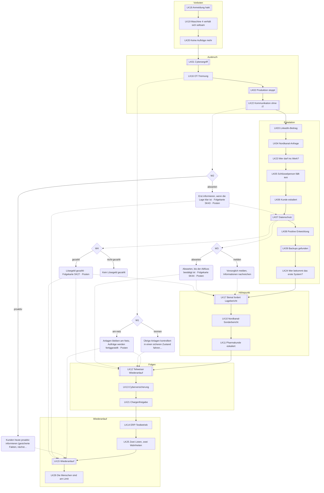

# NordTech: Ablauf und Entscheidungen

Stand: 2026-11-18 · Codestand `0c8013e`

Lagen in Drehbuch-Reihenfolge, gruppiert nach Station. Doppelt umrandet = Priorität 1 (in jeder Dauer enthalten). Rauten = Entscheidungen mit ihren Folgen.

