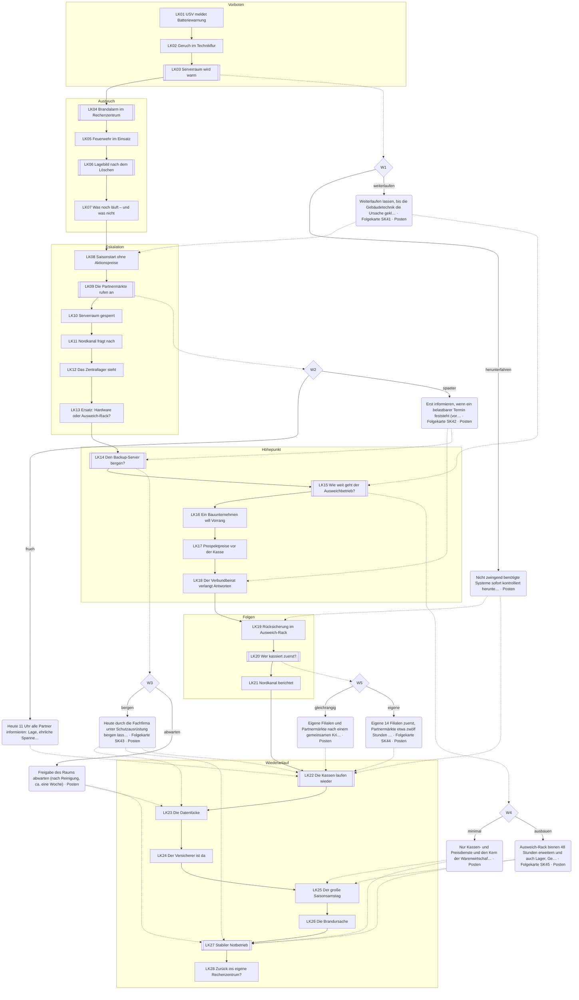

# Waterkant: Ablauf und Entscheidungen

Stand: 2026-11-18 · Codestand `07b0fb2`

Lagen in Drehbuch-Reihenfolge, gruppiert nach Station. Fett umrandet = Priorität 1 (in jeder Dauer enthalten). Rauten = Entscheidungen mit ihren Folgen.

